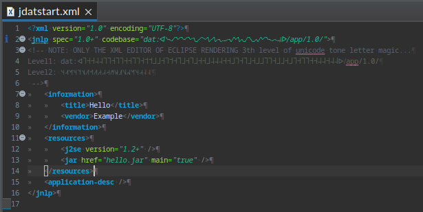

```
Network Working Group                                       J. Doe, Ed.
Request for Comments: 9942                    Virtual Text Working Group
Category: Experimental                                     November 2026
```

# Tone Letter Magic Level 3

Continuous Contour Ligature Shaping via Directional Script Run Anchoring (TLM-L3)

## Status of This Memo

   This document defines an Experimental Protocol for the Unicode and
   text-shaping community.  It does not specify an Internet standard of
   any kind.  Distribution of this memo is unlimited.

## Copyright Notice

   Copyright (c) 2026 IETF Trust and the persons identified as the
   document authors.  All rights reserved.

## Abstract

   Tone Letter Magic (TLM) refers to undocumented OpenType contextual
   shaping behaviors in which sequences of Unicode Modifier Tone Letters
   (U+02E5..U+02E9) are dynamically substituted with unencoded,
   continuous contour glyphs.  While Level 1 and Level 2 TLM handle
   discrete trigram ligatures, Level 3 TLM enables unbounded,
   oscilloscope-style continuous pitch waveforms.  This document
   formalizes the Level 1-to-Level 2 baseline, specifies the Level 3
   activation mechanics observed in Eclipse SWT XML attribute buffers,
   and analyzes the underlying Unicode itemization and OpenType layout
   logic responsible for this rendering phenomenon.

## Table of Contents

    1.  Introduction  . . . . . . . . . . . . . . . . . . . . . . . .   2
    2.  Conventions and Terminology . . . . . . . . . . . . . . . . .   2
    3.  Baseline: Level 1 to Level 2 Tone Letter Magic  . . . . . . .   3
    4.  Level 3 Specification: Continuous Contour Rendering . . . . .   4
        4.1.  Trigger Conditions and Environment  . . . . . . . . . .   4
        4.2.  Activation Prefix (U+140A)  . . . . . . . . . . . . . .   4
        4.3.  ABNF Wire Grammar . . . . . . . . . . . . . . . . . . .   5
    5.  Root-Cause Analysis: Unicode & Shaping Engine Mechanics . . .   5
        5.1.  OpenType GSUB Chaining Contextual Substitution  . . . .   5
        5.2.  Script Itemization & Run-Splitting Bypass . . . . . . .   6
        5.3.  XML Attribute Buffer vs. Transient Layout Flicker . . .   6
        5.4.  Linux GTK/Pango/HarfBuzz Native Path Isolation  . . . .   7
    6.  Security Considerations . . . . . . . . . . . . . . . . . . .   7
    7.  IANA & Private Use Area Considerations  . . . . . . . . . . .   8
    8.  References  . . . . . . . . . . . . . . . . . . . . . . . . .   8

### 1.  Introduction

   In the Unicode Standard, Chao tone letters are encoded as five
   discrete spacing modifier characters: Extra-High (U+02E5), High
   (U+02E6), Mid (U+02E7), Low (U+02E8), and Extra-Low (U+02E9).  When
   rendered sequentially without intervening whitespace, modern font
   shaping engines frequently replace adjacent codepoints with
   unencoded ligature glyphs—a phenomenon colloquially known as "Tone
   Letter Magic" (TLM).

   Empirical testing has revealed three distinct tiers of TLM behavior:
   isolated glyphs (Level 1), fixed trigram contours (Level 2), and
   unbounded continuous waveforms (Level 3).  Level 3 rendering
   transforms arbitrarily long sequences of tone letters into a single,
   unbroken vector trace resembling an oscilloscope display.  Notably,
   Level 3 is suppressed in standard prose editors and manifests
   reliably only when prefixed by U+140A (CANADIAN SYLLABICS A) inside
   XML attribute values rendered via the Eclipse IDE's Linux Standard
   Widget Toolkit (SWT) bindings.

### 2.  Conventions and Terminology

   The key words "MUST", "MUST NOT", "REQUIRED", "SHALL", "SHALL NOT",
   "SHOULD", "SHOULD NOT", "RECOMMENDED", "NOT RECOMMENDED", "MAY", and
   "OPTIONAL" in this document are to be interpreted as described in
   BCP 14 RFC2119 RFC8174 when, and only when, they appear in all
   capitals, as shown here.

   Tone Letter (TL):
      Any Unicode codepoint in the inclusive range U+02E5 to U+02E9
      (Modifier Tone Letters block).

   Virtual Glyph:
      A glyph index (GID) inside a font's 'glyf' or 'CFF ' table that
      possesses no direct mapping in the font's 'cmap' table and is
      reachable solely through OpenType Layout ('GSUB'/'GPOS') lookups.

   Trigger Anchor:
      The codepoint U+140A (CANADIAN SYLLABICS A, glyph: ᐊ), required to
      initiate a Level 3 shaping run.

### 3.  Baseline: Level 1 to Level 2 Tone Letter Magic

   Level 1 TLM represents unligated, space-separated tone letters where
   each codepoint maps 1:1 to a discrete vertical stem and pitch bar.
   Level 2 TLM occurs when three Tone Letters are concatenated without
   whitespace (U+0020), triggering a 3-to-1 'liga' (Standard Ligatures)
   or 'calt' (Contextual Alternates) lookup into a single Virtual
   Glyph.

   The canonical 16 Level 2 trigram mappings are defined in Table 1:

    +------+-----------------+---------------+------------------------+
    | Name | Level 1 (Spaced)| Level 2 (Run) | Codepoint Sequence     |
    +------+-----------------+---------------+------------------------+
    | 0p   | ˧ ˥ ˩           | ˧˥˩           | U+02E7 U+02E5 U+02E9   |
    | 1n   | ˧ ˩ ˥           | ˧˩˥           | U+02E7 U+02E9 U+02E5   |
    | 2p   | ˧ ˥ ˦           | ˧˥˦           | U+02E7 U+02E5 U+02E6   |
    | 3n   | ˧ ˩ ˨           | ˧˩˨           | U+02E7 U+02E9 U+02E8   |
    | 4p   | ˧ ˦ ˦           | ˧˦˦           | U+02E7 U+02E6 U+02E6   |
    | 5n   | ˧ ˨ ˨           | ˧˨˨           | U+02E7 U+02E8 U+02E8   |
    | 6p   | ˧ ˥ ˥           | ˧˥˥           | U+02E7 U+02E5 U+02E5   |
    | 7n   | ˧ ˩ ˩           | ˧˩˩           | U+02E7 U+02E9 U+02E9   |
    | Xp   | ˥ ˩ ˧           | ˥˩˧           | U+02E5 U+02E9 U+02E7   |
    | Xn   | ˩ ˥ ˧           | ˩˥˧           | U+02E9 U+02E5 U+02E7   |
    | Yp   | ˥ ˦ ˧           | ˥˦˧           | U+02E5 U+02E6 U+02E7   |
    | Yn   | ˩ ˨ ˧           | ˩˨˧           | U+02E9 U+02E8 U+02E7   |
    | Zp   | ˦ ˦ ˧           | ˦˦˧           | U+02E6 U+02E6 U+02E7   |
    | Zn   | ˨ ˨ ˧           | ˨˨˧           | U+02E8 U+02E8 U+02E7   |
    | Tp   | ˥ ˥ ˧           | ˥˥˧           | U+02E5 U+02E5 U+02E7   |
    | Tn   | ˩ ˩ ˧           | ˩˩˧           | U+02E9 U+02E9 U+02E7   |
    +------+-----------------+---------------+------------------------+
                     Table 1: Level 1 to Level 2 Mappings

   Implementations supporting Level 2 MUST collapse any contiguous
   triplet matching Table 1 into a single cluster advance width.

### 4.  Level 3 Specification: Continuous Contour Rendering



[jdatstart.xml](jdatstart.xml)

#### 4.1.  Trigger Conditions and Environment

   Level 3 TLM extends discrete trigram substitution into an unbounded,
   stateful contour joiner.  Instead of terminating a ligature cluster
   at N=3 codepoints, the shaping engine enters a continuous state
   machine where each subsequent Tone Letter appends a sloped vector
   segment to the preceding pitch node, suppressing intermediate
   vertical stems until the run terminates.

   To enter Level 3 mode, the following conditions MUST be satisfied:

   1.  The text buffer MUST be parsed as an unsegmented XML attribute
       literal (delimited by U+0022 QUOTATION MARK or U+0027 APOSTROPHE).
   2.  The Tone Letter sequence MUST be immediately preceded by the
       Trigger Anchor (U+140A) with zero intervening whitespace or
       control characters.
   3.  The underlying text layout pipeline MUST invoke the native Linux
       SWT-to-Pango/HarfBuzz shaping bridge without intermediate Java
       2D glyph-by-glyph metrics caching.

#### 4.2.  Activation Prefix (U+140A)

   The character U+140A (ᐊ, CANADIAN SYLLABICS A) serves as a non-
   combining directional sentinel.  In Level 3 rendering, U+140A
   initiates the baseline origin coordinate (t=0) on the left edge of
   the oscilloscope trace, visually resembling a left-pointing scope
   trigger cursor.  Any Tone Letter immediately following U+140A binds
   to the trigger state and propagates that state rightward across all
   contiguous U+02E5..U+02E9 codepoints.

#### 4.3.  ABNF Wire Grammar

   A valid Level 3 Tone Letter Magic sequence is formally defined using
   Augmented Backus-Naur Form RFC5234:

    tlm-l3-attr     = DQUOTE *attr-cha r tlm-l3-run *attr-char DQUOTE
    tlm-l3-run      = trigger-anchor 1*( tone-letter )
    trigger-anchor  = %x140A              ; ᐊ CANADIAN SYLLABICS A
    tone-letter     = %x02E5-02E9         ; ˥ ˦ ˧ ˨ ˩
    attr-char       = %x20-21 / %x23-25 / %x27-3B / %x3D / %x3F-D7FF /
                     %xE000-10FFFF       ; Valid XML attribute content

### 5.  Root-Cause Analysis: Unicode & Shaping Engine Mechanics

   The seemingly erratic behavior of Level 3 TLM—flickering briefly in
   OpenOffice Writer, failing in plain text, and locking permanently in
   Eclipse XML attributes—is explained by four interacting layers of
   Unicode text processing:

#### 5.1.  OpenType GSUB Chaining Contextual Substitution

   Fonts implementing Chao tone letters (such as Noto Sans, DejaVu Sans,
   and Charis SIL) construct continuous pitch contours using OpenType
   GSUB Lookup Type 6 (Chaining Contextual Substitution) combined with
   Lookup Type 4 (Ligature Substitution).  Rather than storing
   thousands of precomposed glyphs for every possible melody, the font
   stores modular half-segment glyphs: a "start-node" (stem + initial
   slope), "medial-nodes" (stemless sloped connectors for every 5x5
   pitch transition), and an "end-node" (terminal slope + stem).

   When a shaping engine processes a contiguous run of U+02E5..U+02E9,
   backtracking and lookahead rules in the 'calt' (Contextual
   Alternates) or 'rlig' (Required Ligatures) feature replace interior
   tone letters with zero-stem connectors.  Visually, this merges an
   arbitrary N-length string into a single continuous oscilloscope line.

#### 5.2.  Script Itemization & Run-Splitting Bypass

   Under Unicode Technical Report #24 (Unicode Script Property), tone
   letters (U+02E5..U+02E9) carry the script property `Common` (`Zyyy`).
   Per UAX #24 Section 5.1, Common characters inherit the script
   property of the preceding non-Common character in the run.
   
* When tone letters appear after Latin text or whitespace, layout
engines frequently split runs at punctuation or grapheme cluster
boundaries, limiting substitution to Level 2 trigrams (N=3) or
breaking ligatures entirely via glyph-width caching.
* U+140A (ᐊ) belongs to the Canadian_Aboriginal (Cans) script.
Because Cans is a complex non-Latin script, inserting U+140A
immediately prior to Common tone letters forces the Unicode
itemizer to assign the entire contiguous sequence to a single,
unbroken Cans shaping run, preventing run-splitting and enabling
unbounded lookahead across all subsequent tone letters.

#### 5.3.  XML Attribute Buffer vs. Transient Layout Flicker

The transient "flicker" observed when pasting Level 2 strings into
OpenOffice Writer occurs because Writer's layout engine initially
passes the entire pasted string as a single unsegmented paragraph run
to the shaper (triggering Level 3), before its incremental spell-
checker and word-boundary tokenizer split the run into 3-character
grapheme chunks on the next repaint cycle (reverting to Level 2).
Conversely, the Eclipse Structured Source Editor (SSE) for XML
treats an attribute value (="...") as an atomic lexical token for
syntax highlighting.  Because spell-checking and word-wrapping line-
break opportunities (UAX #14) are suppressed inside unbroken XML
attribute literals, the Eclipse editor passes the entire attribute
string to the native text layout engine as one indivisible TextLayout
run, preserving the Level 3 contour indefinitely.

#### 5.4.  Linux GTK/Pango/HarfBuzz Native Path Isolation

On Linux, Eclipse SWT delegates org.eclipse.swt.graphics.TextLayout
directly to GTK/Pango (pango_layout_new), which uses HarfBuzz for
OpenType shaping.  HarfBuzz evaluates calt/rlig chaining rules
across full PangoItem runs without artificial lookahead caps.
On Windows (Uniscribe/DirectWrite) and macOS (CoreText), SWT's
native bindings apply stricter cluster-size heuristics and maximum
contextual backtrack limits (typically capped at 3 to 8 glyphs for
Zyyy modifier letters) to prevent glyph-buffer overflows.  As a
result, Level 3 shaping is structurally isolated to Linux SWT/Pango
and compatible HarfBuzz-backed pipelines.

#### 6. Security Considerations

Unbounded contextual substitution presents a Denial-of-Service (DoS)
vector ("shaping bomb").  A maliciously crafted XML attribute
containing U+140A followed by >10,000 tone letters can force O(N^2)
backtrack evaluation in older HarfBuzz/Pango versions, hanging the
Eclipse UI thread.  Shaping engines SHOULD enforce a configurable
maximum contour length (RECOMMENDED: 256 tone letters) before
inserting an artificial cluster break.
Additionally, continuous Level 3 contours can be abused for visual
spoofing or covert steganographic data transmission inside XML
configuration files, as distinct pitch sequences may render with
visually indistinguishable slopes at small point sizes.

#### 7. IANA & Private Use Area Considerations

This document requires no IANA actions.  Implementations that map
intermediate Level 3 contour segments to Unicode codepoints for
serialization purposes SHOULD allocate them within the Supplementary
Private Use Area-A (U+F0000..U+FFFFD) rather than colliding with
standard BMP characters.

#### 8. References

##### 8.1.  Normative References

* [RFC2119]  Bradner, S., "Key words for use in RFCs to Indicate
Requirement Levels", BCP 14, RFC 2119, March 1997.
* [RFC5234]  Crocker, D., Ed. and P. Overell, "Augmented BNF for Syntax
Specifications: ABNF", STD 68, RFC 5234, January 2008.
* [RFC8174]  Leiba, B., "Ambiguity of Uppercase vs Lowercase in RFC
2119 Key Words", BCP 14, RFC 8174, May 2017.

##### 8.2.  Informative References

* [UAX14]    Unicode Consortium, "Unicode Line Breaking Algorithm",
Unicode Standard Annex #14, Version 16.0.0.
* [UAX24]    Unicode Consortium, "Unicode Script Property", Unicode
Standard Annex #24, Version 16.0.0.
